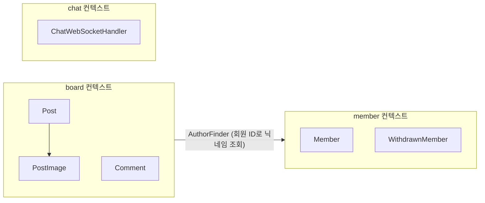

# backend-tech-poc

회원, 게시판, 댓글, 랜덤 채팅, 소셜 로그인을 갖춘 Spring Boot 백엔드다.

2022년에 기술을 하나씩 붙여 보며 만든 프로젝트를 2026년에 다시 정리했다. 기능은 거의 그대로 두고 코드를 도메인 경계에 따라 다시 나눴다. 나누다가 찾은 보안 버그는 고친 뒤 테스트로 막아 두었다.

## 기술 스택

| 구분 | 사용한 것 |
|---|---|
| 언어와 프레임워크 | Java 25, Spring Boot 4.1, Spring Security 7 |
| 데이터 | MySQL 8.4, Spring Data JPA, OpenFeign QueryDSL 7, Flyway |
| 캐시와 임시 저장 | Redis에 리프레시 토큰과 인증 코드, 조회 기록을 둔다 |
| 인증 | jjwt 0.13으로 만든 JWT, 구글과 카카오와 네이버 OAuth2 로그인 |
| 실시간 | WebSocket |
| 문서 | springdoc-openapi와 Swagger UI |
| 테스트 | JUnit 5, MockMvc, Testcontainers |
| 실행 환경 | Docker, Docker Compose, Mailpit |

## 구조

코드를 세 개의 바운디드 컨텍스트로 나눴다. 컨텍스트끼리는 서로의 내부를 모르고, 정해 둔 인터페이스 하나로만 이어진다.



| 컨텍스트 | 하는 일 | 애그리거트 |
|---|---|---|
| `member` | 회원가입, 로그인과 토큰, 비밀번호 재설정, 관리자 회원 조회 | `Member`, `WithdrawnMember` |
| `board` | 게시글, 이미지, 댓글과 답글, 조회수 | 이미지를 품은 `Post`, `Comment` |
| `chat` | 익명 랜덤 채팅 | 없다. DB에 아무것도 남기지 않는다 |

각 컨텍스트 안은 같은 네 층으로 나눴다. 위층은 아래층만 부르고, 아래층은 위층을 모른다.

```
board/
├── api/             컨트롤러. 요청을 받아 서비스에 넘기기만 한다
├── application/     서비스. 하나의 기능을 처음부터 끝까지 이끈다
│   ├── dto/         요청과 응답 record
│   └── port/        바깥(DB 조회, Redis, 파일, 다른 컨텍스트)에 바라는 것을 적은 인터페이스
├── domain/          엔티티와 규칙. 스프링 없이도 테스트할 수 있다
└── infrastructure/  port의 실제 구현 (QueryDSL, Redis, 로컬 디스크)
```

여러 컨텍스트가 함께 쓰는 것은 `common`에 두었다. 보안 설정, JWT, 오류 응답 형식, 페이지 응답 형식이 여기에 있다.

## 설계하면서 정한 것

### 게시글과 댓글을 다른 애그리거트로 나눴다

이미지는 게시글 없이는 의미가 없고 개수도 적어서 `Post` 안에 넣었다. 이미지를 붙이고 떼는 일은 `Post`의 메서드로만 할 수 있고, 그 메서드가 글쓴이인지 먼저 확인한다.

댓글은 수천 개가 달릴 수 있다. `Post` 안에 넣으면 글 하나를 불러올 때마다 댓글을 모두 불러와야 해서 `Comment`를 따로 두고 게시글은 ID로만 가리키게 했다. 답글은 한 단계까지만 허용한다. 예전에는 `replyType`과 `replyGroup` 두 칸으로 답글을 표현했는데, 그룹 번호를 게시글과 상관없이 전체 댓글에서 이어 매겼고, 답글을 찾을 때도 게시글을 보지 않아서 다른 글의 답글이 섞일 수 있었다. 지금은 `parentId` 하나로 표현한다.

### 게시판은 회원을 직접 참조하지 않는다

게시글과 댓글에는 글을 쓸 때의 회원 ID와 닉네임을 `Author` 값 객체로 복사해 둔다. `post` 테이블에서 `member` 테이블로 외래 키도 걸지 않았다.

이렇게 하면 글 목록을 볼 때 회원 테이블과 조인하지 않아도 되고, 회원이 탈퇴해도 글은 남는다. 대신 닉네임을 바꾸면 예전 글에는 예전 닉네임이 보인다. 이 서비스에서는 받아들일 만한 차이라고 보았다.

회원 정보가 필요한 곳은 `AuthorFinder` 인터페이스 하나뿐이다. 회원 쪽 구조가 바뀌면 그 구현인 `MemberAuthorFinder`만 고치면 된다.

### 누가 요청했는지는 토큰으로만 정한다

예전 API는 요청 본문에 `userId`를 받아서 그 값으로 글을 쓰고 고쳤다. 다른 사람의 ID를 넣으면 남의 글과 정보를 고칠 수 있었다.

지금은 JWT 필터가 토큰에서 회원 ID를 꺼내 두고, 컨트롤러는 `@AuthenticationPrincipal Long memberId`로만 받는다. 요청 본문에 회원 ID를 넣어도 무시한다.

### 조회수는 Redis로 중복을 막고 UPDATE 한 번으로 올린다

같은 회원이 같은 글을 하루에 여러 번 열어도 조회수는 한 번만 오른다. 예전에는 조회 기록을 DB 테이블에 쌓았는데, 기록은 하루만 지나면 필요 없어서 Redis에 하루짜리 키로 남기도록 바꿨다. `SET NX`는 한 번에 실행되므로 같은 회원이 동시에 두 번 열어도 한 번만 통과한다.

숫자를 올릴 때는 엔티티를 읽어서 더하지 않고 `update post set view_count = view_count + 1`을 한 번 실행한다. 읽고 더하고 쓰는 사이에 다른 요청이 끼어들면 올린 숫자가 사라지기 때문이다.

### 리프레시 토큰은 한 번만 쓸 수 있다

리프레시 토큰을 쓰면 새 토큰을 주고 예전 토큰은 버린다. 회원마다 최신 토큰 하나만 Redis에 기억해 두고, 들어온 토큰이 그것과 다르면 거절한다. 토큰을 도둑맞아도 원래 주인이 한 번 재발급하면 도둑이 가진 토큰은 쓸 수 없게 된다.

액세스 토큰과 리프레시 토큰은 같은 키로 서명하므로 `type` 값을 넣어 구분한다. 예전에는 이 구분이 없어서 리프레시 토큰을 액세스 토큰 자리에 넣으면 서명 검사는 통과하고, 그 뒤 권한 정보를 꺼내다 500 오류가 났다.

### 이미지 파일은 트랜잭션 결과를 보고 지운다

DB는 되돌릴 수 있지만 디스크에 쓴 파일은 되돌릴 수 없다. 그래서 파일 정리를 트랜잭션이 끝난 뒤로 미뤘다.

| 상황 | 하는 일 |
|---|---|
| 파일을 저장했는데 트랜잭션이 실패했다 | 저장한 파일을 지운다 (`AFTER_ROLLBACK`) |
| 이미지나 게시글을 지운 트랜잭션이 성공했다 | 그 파일을 지운다 (`AFTER_COMMIT`) |

파일 이름은 사용자가 보낸 이름 대신 UUID로 새로 만든다. 지울 때는 서버가 DB에서 찾은 경로만 쓰고, 그 경로가 업로드 폴더 안인지 한 번 더 확인한다.

### 비밀값은 저장소에 두지 않는다

예전에는 Jasypt로 설정 파일 일부를 암호화했는데 JWT 서명 키는 평문으로 남아 있었다. 암호를 푸는 키도 결국 어딘가에 두어야 해서 지금은 Jasypt를 걷어 내고 모든 비밀값을 환경변수로 받는다. 로컬에서는 Git에 올리지 않는 `.env` 파일에 적는다.

## 리팩터링하면서 고친 버그

구조를 바꾸면서 예전 코드를 다시 읽다가 아래 문제를 찾았다. 모두 고쳤고, 다시 생기지 않도록 테스트를 붙였다.

| 문제 | 원인 | 막는 테스트 |
|---|---|---|
| 임시 비밀번호를 발급하면 모든 회원의 비밀번호가 바뀐다 | `update` 쿼리에 `where` 조건이 없었다 | `AuthApiTest.비밀번호를_재설정하면_그_회원의_비밀번호만_바뀐다` |
| 서버의 아무 파일이나 지울 수 있다 | 이미지를 지울 때 클라이언트가 보낸 파일 경로를 그대로 썼다 | `PostApiTest.이미지를_올리고_지우면_파일도_함께_지워진다` |
| 남의 글과 회원 정보를 고치거나 지울 수 있다 | 요청 본문의 `userId`를 믿었다 | `PostApiTest.다른_회원은_글을_고치거나_지울_수_없다` |
| 로그인과 관리자 조회 응답에 비밀번호 해시가 담긴다 | 엔티티 필드를 응답 DTO로 통째로 복사했다 | `MemberApiTest.관리자는_비밀번호_없이_일반_회원_목록을_본다` |
| 비밀번호 변경이 항상 실패한다 | 평문 비밀번호를 해시값과 `=`로 비교했다 | `MemberApiTest.비밀번호를_바꾸면_새_비밀번호로만_로그인된다` |
| 회원별 글 목록에 엉뚱한 글이 나온다 | 조인 조건에 회원 ID 대신 게시글 ID를 넣었다 | `PostApiTest.회원이_쓴_글만_모아_볼_수_있다` |
| 리프레시 토큰을 액세스 토큰 자리에 넣으면 401이 아니라 500 오류가 난다 | 토큰 종류를 구분하지 않았다 | `AuthApiTest.액세스_토큰과_리프레시_토큰은_서로_바꿔_쓸_수_없다` |
| 회원 ID와 게시글 ID가 커지면 글을 열 때 오류가 난다 | `userId_boardId` 형태의 조회 기록 키를 `VARCHAR(10)` 칸에 넣었다 | `PostApiTest.같은_회원이_여러_번_봐도_조회수는_한_번만_오른다` |

예전 저장소 이력에는 DB 접속 정보와 SMTP 비밀번호, JWT 서명 키가 평문으로 남아 있었다. 해당 파일을 Git 이력 전체에서 지웠다.

## 테스트

```bash
./gradlew test
```

Docker가 켜져 있어야 한다. Testcontainers가 MySQL 8.4와 Redis 7.4를 띄우고, Flyway 마이그레이션부터 API 호출까지 운영과 같은 DB에서 확인한다. 테스트는 모두 39개다.

| 종류 | 클래스 | 확인하는 것 |
|---|---|---|
| API 통합 테스트 | `MemberApiTest`, `AuthApiTest`, `PostApiTest`, `CommentApiTest` | 요청부터 DB와 Redis, 파일까지 실제로 거친 결과 |
| 도메인 단위 테스트 | `PostTest`, `CommentTest` | 글쓴이 확인, 답글 깊이 같은 규칙. 스프링 없이 돈다 |

테스트 이름은 무엇을 보장하는지 한글 문장으로 적었다. 실패하면 이름만 보고도 어떤 약속이 깨졌는지 알 수 있다.

## 실행

Java 25와 Docker가 필요하다.

```bash
cp .env.example .env     # 빈칸(DB_PASSWORD, DB_ROOT_PASSWORD, JWT_SECRET)을 채운다
docker compose up -d     # MySQL, Redis, Mailpit
./gradlew bootRun
```

| 주소 | 내용 |
|---|---|
| http://localhost:8080/swagger-ui.html | API 문서 |
| http://localhost:8080/sns | 소셜 로그인 데모 화면 |
| http://localhost:8025 | Mailpit. 비밀번호 재설정 메일을 여기서 확인한다 |
| ws://localhost:8080/ws/chat | 랜덤 채팅 |

소셜 로그인을 써 보려면 각 개발자 콘솔에서 키를 발급받아 `.env`의 주석을 풀고 적는다.

## API

목록 API의 `page`는 1부터 센다. 응답에는 전체 개수(`totalElements`)와 전체 페이지 수(`totalPages`)가 함께 온다. 오류는 모두 [RFC 9457](https://www.rfc-editor.org/rfc/rfc9457) 형식이고, `code` 칸에 오류 종류가 담긴다.

| 메서드 | 경로 | 설명 |
|---|---|---|
| POST | `/api/v1/members` | 회원가입 |
| GET, PATCH, DELETE | `/api/v1/members/me` | 내 정보 보기, 고치기, 탈퇴 |
| PATCH | `/api/v1/members/me/password` | 비밀번호 바꾸기 |
| POST | `/api/v1/auth/login` | 로그인 |
| POST | `/api/v1/auth/reissue` | 토큰 재발급 |
| POST | `/api/v1/auth/logout` | 로그아웃 |
| POST | `/api/v1/auth/password-reset/code` | 비밀번호 재설정 코드 받기 |
| POST | `/api/v1/auth/password-reset` | 코드 확인 후 임시 비밀번호 받기 |
| GET | `/api/v1/admin/members`, `/api/v1/admin/members/{memberId}` | 관리자 회원 조회 |
| POST, GET | `/api/v1/posts` | 글쓰기, 글 목록 |
| GET, PATCH, DELETE | `/api/v1/posts/{postId}` | 글 보기, 고치기, 지우기 |
| GET | `/api/v1/members/{memberId}/posts` | 회원이 쓴 글 목록 |
| POST | `/api/v1/posts/{postId}/images` | 이미지 올리기 |
| DELETE | `/api/v1/posts/{postId}/images/{imageId}` | 이미지 지우기 |
| POST, GET | `/api/v1/posts/{postId}/comments` | 댓글과 답글 쓰기, 댓글 목록 |
| GET | `/api/v1/comments/{commentId}/replies` | 답글 목록 |

## 아직 남은 것

알고 있지만 이번 범위에서 다루지 않은 것들이다.

- 비밀번호 재설정 코드는 6자리 숫자라서, 5분 안에 시도 횟수를 제한하지 않으면 계속 대입해 맞힐 수 있다. 이메일마다 시도 횟수를 세는 제한이 필요하다.
- 채팅 접속자 목록을 서버 메모리에 두어서 서버가 여러 대면 서로의 메시지를 보지 못한다. Redis Pub/Sub로 메시지를 중계해야 한다.
- 소셜 로그인은 로그인 화면까지만 보여 주는 데모다. 소셜 계정을 회원과 연결하고 JWT를 발급하는 흐름은 없다.
- 올린 이미지를 내려받는 API가 없다.

## 데모 영상

2022년 버전에서 찍은 영상이다. 화면은 지금과 조금 다르다.

랜덤 채팅

https://user-images.githubusercontent.com/59010442/183376056-54172813-c93a-4d66-88d0-1fadbe327187.mp4

소셜 로그인 (카카오, 네이버, 구글)

https://user-images.githubusercontent.com/59010442/186295971-d303baf5-8746-4bac-aaab-28e0e32c51a2.mp4
