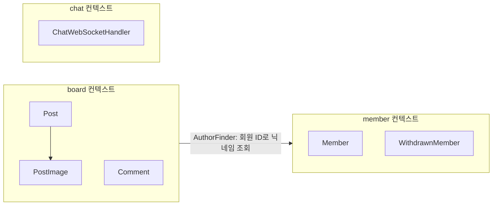
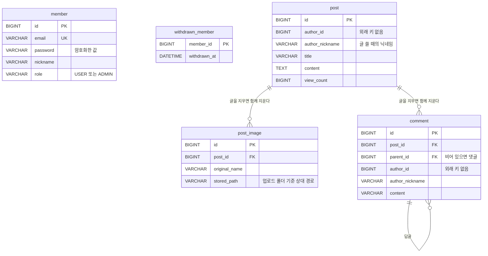
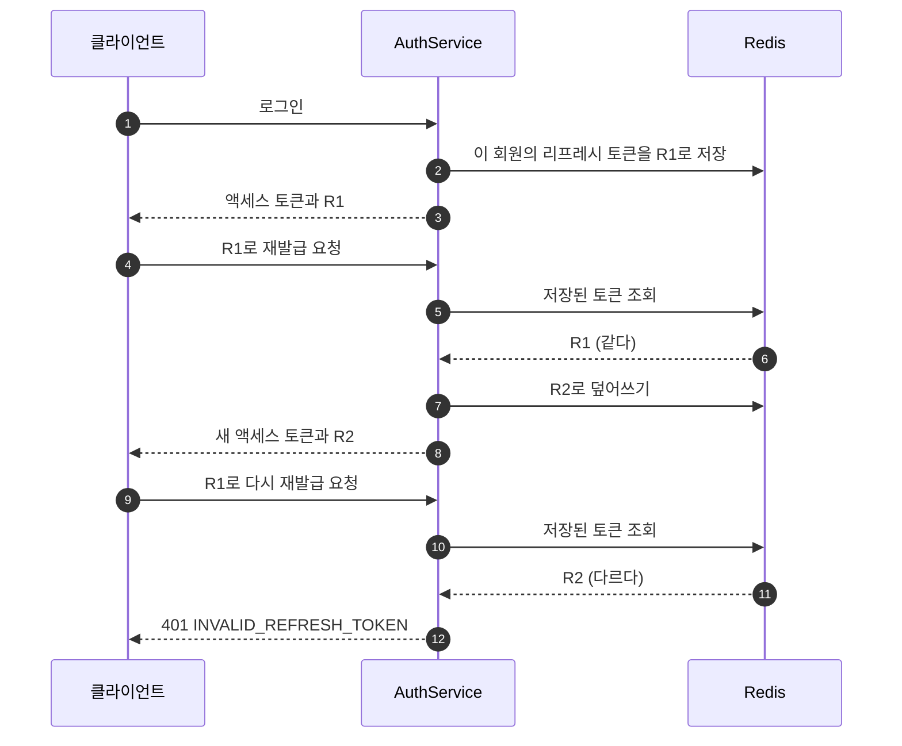
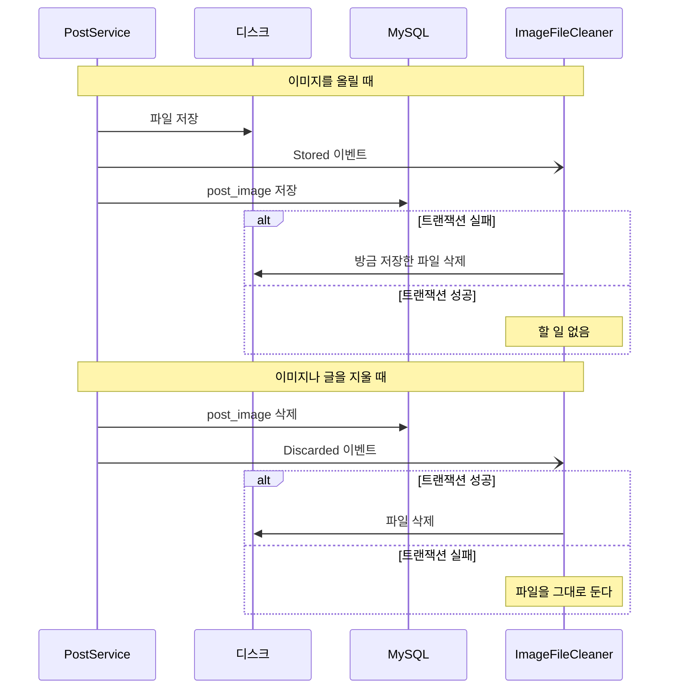

# 설계 문서

README에서 짧게 적은 구조와 설계 결정을 그림과 함께 자세히 적는다. 코드가 바뀌면 같은 커밋에서 이 문서도 고친다.

## 컨텍스트와 층

코드는 `member`, `board`, `chat` 세 개의 바운디드 컨텍스트로 나뉜다. 게시판은 회원 정보가 필요할 때 `AuthorFinder` 인터페이스 하나만 부른다.



각 컨텍스트 안은 같은 네 층으로 나눴다. 위층은 아래층만 부르고 아래층은 위층을 모른다.

```
board/
├── api/             컨트롤러. 요청을 받아 서비스에 넘기기만 한다
├── application/     서비스. 하나의 기능을 처음부터 끝까지 이끈다
│   ├── dto/         요청과 응답 record
│   └── port/        바깥(DB 조회, Redis, 파일, 다른 컨텍스트)에 바라는 것을 적은 인터페이스
├── domain/          엔티티와 규칙
└── infrastructure/  port의 실제 구현 (QueryDSL, Redis, 로컬 디스크)
```

`port`를 둔 이유는 서비스가 Redis나 디스크 같은 기술을 몰라도 되게 하려는 것이다. 서비스는 "처음 보는 글인지 기록해 줘"라고만 말하고, Redis를 쓸지 DB를 쓸지는 `infrastructure`가 정한다.

여러 컨텍스트가 함께 쓰는 것은 `common`에 두었다. 보안 설정과 JWT, 오류 응답 형식, 페이지 응답 형식이 여기에 있다.

## 테이블

스키마는 Flyway가 `src/main/resources/db/migration`의 SQL로 만든다. JPA는 스키마를 만들지 않고 엔티티와 테이블이 맞는지만 확인한다(`ddl-auto: validate`).



`member`와 `post` 사이에는 선이 없다. 외래 키는 같은 컨텍스트 안에서만 걸고 컨텍스트를 넘어서는 걸지 않았다. 아래 「게시판은 회원을 직접 참조하지 않는다」에 이유를 적었다.

## 게시글과 댓글을 다른 애그리거트로 나눴다

이미지는 게시글 없이는 의미가 없고 개수도 적어서 `Post` 안에 넣었다. 이미지를 붙이고 떼는 일은 `Post`의 메서드로만 할 수 있고, 그 메서드가 글쓴이인지 먼저 확인한다.

댓글은 수천 개가 달릴 수 있다. `Post` 안에 넣으면 글 하나를 불러올 때마다 댓글을 모두 불러와야 해서 `Comment`를 따로 두고 게시글은 ID로만 가리키게 했다.

답글은 한 단계까지만 허용한다. 예전에는 `replyType`과 `replyGroup` 두 칸으로 답글을 표현했다. 그런데 그룹 번호를 게시글과 상관없이 전체 댓글에서 이어 매겼고 답글을 찾을 때도 게시글을 보지 않아서 다른 글의 답글이 섞일 수 있었다. 지금은 `parentId` 하나로 표현한다.

## 게시판은 회원을 직접 참조하지 않는다

게시글과 댓글에는 글을 쓸 때의 회원 ID와 닉네임을 `Author` 값 객체로 복사해 둔다. 테이블에서도 `post.author_id`에 외래 키를 걸지 않았다.

이렇게 하면 글 목록을 볼 때 회원 테이블과 조인하지 않아도 되고, 회원이 탈퇴해도 글은 남는다. 대신 닉네임을 바꾸면 예전 글에는 예전 닉네임이 보인다. 이 서비스에서는 받아들일 만한 차이라고 보았다.

회원 정보가 필요한 곳은 `AuthorFinder` 하나뿐이다. 회원 쪽 구조가 바뀌면 그 구현인 `MemberAuthorFinder`만 고치면 된다.

## 누가 요청했는지는 토큰으로만 정한다

예전 API는 요청 본문에 `userId`를 받아서 그 값으로 글을 쓰고 고쳤다. 다른 사람의 ID를 넣으면 남의 글과 정보를 고칠 수 있었다.

지금은 `JwtAuthenticationFilter`가 토큰에서 회원 ID를 꺼내 두고 컨트롤러는 `@AuthenticationPrincipal Long memberId`로만 받는다. 요청 본문에 회원 ID를 넣어도 무시한다.

## 조회수는 Redis로 중복을 막고 UPDATE 한 번으로 올린다

같은 회원이 같은 글을 하루에 여러 번 열어도 조회수는 한 번만 오른다. 예전에는 조회 기록을 DB 테이블에 쌓았는데, 기록은 하루만 지나면 필요 없어서 Redis에 하루짜리 키로 남기도록 바꿨다. `SET NX`는 한 번에 실행되므로 같은 회원이 동시에 두 번 열어도 한 번만 통과한다.

숫자를 올릴 때는 엔티티를 읽어서 더하지 않고 `update post set view_count = view_count + 1`을 한 번 실행한다. 읽고 더하고 쓰는 사이에 다른 요청이 끼어들면 올린 숫자가 사라지기 때문이다.

## 리프레시 토큰은 한 번만 쓸 수 있다

리프레시 토큰을 쓰면 새 토큰을 주고 예전 토큰은 버린다. 회원마다 가장 최근에 준 토큰 하나만 Redis에 기억해 두고 들어온 토큰이 그것과 다르면 거절한다.



토큰을 도둑맞아도 원래 주인이 한 번 재발급하면 도둑이 가진 토큰은 쓸 수 없다. 로그아웃하거나 비밀번호를 바꾸면 Redis에서 리프레시 토큰을 지운다. 이미 나간 액세스 토큰은 만료될 때까지 30분 동안 쓸 수 있고, 그 뒤에는 다시 로그인해야 한다.

액세스 토큰과 리프레시 토큰은 같은 키로 서명하므로 `type` 값을 넣어 구분한다. 예전에는 이 구분이 없어서 리프레시 토큰을 액세스 토큰 자리에 넣으면 서명 검사는 통과하고, 그 뒤 권한 정보를 꺼내다 500 오류가 났다.

## 이미지 파일은 트랜잭션 결과를 보고 지운다

DB는 되돌릴 수 있지만 디스크에 쓴 파일은 되돌릴 수 없다. 그래서 `PostService`는 파일을 직접 지우지 않고 이벤트만 남긴다. `ImageFileCleaner`가 트랜잭션이 끝난 결과를 보고 파일을 정리한다.



파일 이름은 사용자가 보낸 이름 대신 UUID로 새로 만든다. 지울 때는 서버가 DB에서 찾은 경로만 쓰고, 그 경로가 업로드 폴더 안인지 한 번 더 확인한다. 예전 코드는 클라이언트가 보낸 경로로 파일을 지워서 서버의 아무 파일이나 지울 수 있었다.

## 비밀값은 저장소에 두지 않는다

예전에는 Jasypt로 설정 파일 일부를 암호화했는데 JWT 서명 키는 평문으로 남아 있었다. 암호를 푸는 키도 결국 어딘가에 두어야 해서 지금은 Jasypt를 걷어 내고 모든 비밀값을 환경변수로 받는다. 로컬에서는 Git에 올리지 않는 `.env` 파일에 적고, 테스트는 실행할 때마다 JWT 키를 새로 만든다.
